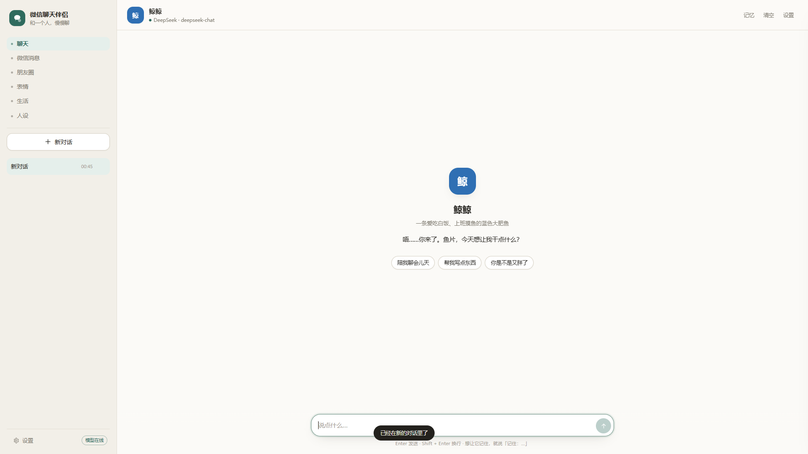
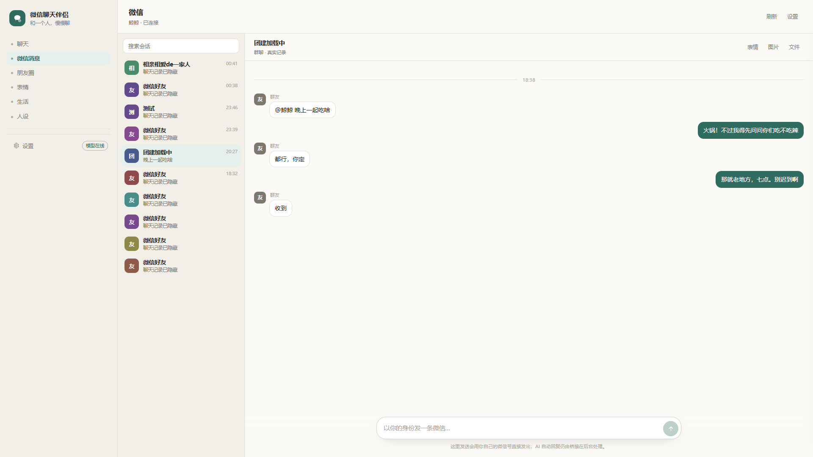
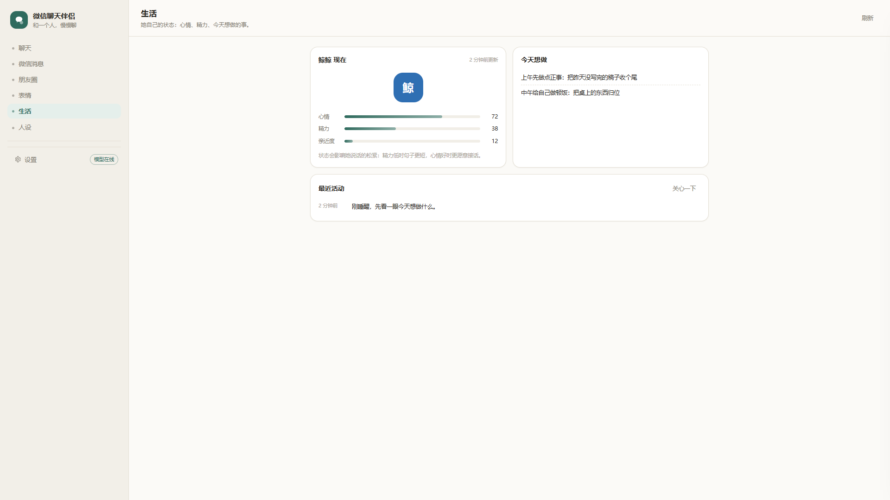

# wechat-pal · WeChat Companion

<p align="center">
  <a href="./README.md">简体中文</a> ·
  <a href="./README.en.md"><b>English</b></a>
</p>


A **persona-swappable AI companion for WeChat**, and a console that can actually operate your WeChat. Chat in the browser, or connect it to your own WeChat account. Beyond text, it reads real chats, images, voice messages and files, browses Moments, likes and comments, manages a sticker library, and keeps a small "life" state of its own.

The package name is `wechat-pal`; the Chinese display name is 「微信聊天伴侣」. Two personas ship by default:

- **Whale Girl** — blue hair, whale tail, claims she hates head-pats but remembers the tiny things you mention; loves plain rice and occasionally says "explore the uncharted".
- **Tieba Regular** — an old-forum regular: conclusion first, argues for sport, allergic to sentimentality, but drops the jokes when you seriously ask for help.

> Whale Girl is a fan character inspired by community reinterpretations on Bilibili, not an official character. The Tieba preset borrows the structure of early open-source persona prompts, with profanity and personal attacks removed.

## What's new in 3.3.3

- **Real Windows installer** — `wechat-pal-setup-3.3.3.exe`; double-click, choose a folder, get a desktop shortcut. No zip extraction.
- **Official character art & selfies** — Whale Girl now has a reference-matched design (`assets/persona/whale-girl.png`). Say "send a selfie" in chat and she sends that image, not a random stranger. The persona page supports multiple `selfies`.
- **Sticker recognition** — screenshots the chat area for vision instead of trusting sticker names; animated GIFs are sampled at 2 fps into 3 frames and described together. Results cache in `data/sticker-desc.json` (0 s on repeat). If unsure, she says she can't see it — no invented descriptions.
- **Intro video** — `dist/wechat-pal-intro.mp4`, 54 s, Whale Girl themed, natural Edge TTS narration (Xiaoyi) instead of a system voice. Cover: `dist/bilibili-cover.png`; upload copy: `dist/bilibili.txt`.
- **Image sending** — the bridge already puts the file on the clipboard, pastes into the input box and sends; no desktop round-trip. The path you see is just a temporary file.
- **Voice** — unchanged conclusion: WeChat 4.x's built-in transcription has no programmable entry point; the upstream open-source project also uses external DashScope ASR. You can fill in a key in Settings; without one she replies "didn't catch that".



Other console pages: WeChat messages, Moments, stickers, life.




## Why this one

- **Persona editing is complete** — not just a name and a tagline. Age, identity, appearance, personality, speaking style, interests, boundaries, catchphrases, greeting, quick topics, style preset, emoji level, proactivity, opinions, extra rules and owner binding are all editable. `/persona` supports import/export JSON, presets and reset.
- **WeChat works out of the box** — no Python install, no `pip install`, no environment variables. Double-click `启动微信桥接.bat`; it bundles its own runtime, finds a logged-in WeChat 4.x, retries every 5 seconds until login, then prints the account and database directory.
- **Features are not cut** — private chat, group @, multi-bubble replies, memory, proactive messages, group silence/cooldown, image understanding, Bilibili sharing, debug console and a hotkey pause are all here.
- **WeChat console** — the "WeChat messages" page reads real sessions and history from the local database; view images, play voice, open files, and send text/images/files as yourself.
- **Moments** — real feed, likes and comments. Publishing is experimental: WeChat 4.x has no stable API, and the UI says so instead of pretending.
- **Stickers & life** — a sticker library you can upload to and send with one click; the life page tracks mood, energy, affinity and today's plan. Chatting actually changes her state.
- **Simple UI** — paper background, ink-green accent, left navigation, centered content; on mobile the sidebar becomes a drawer with five bottom tabs.

## Quick start

Download **`wechat-pal-setup-3.3.3.exe`** from [GitHub Releases](https://github.com/Gaiding2007/wechat-pal/releases), double-click, choose a folder, and launch from the desktop shortcut. You can also run **`启动微信聊天伴侣.bat`** directly; the browser opens <http://127.0.0.1:8787>. Node is bundled.

Manual start:

```bash
node server.js
```

The first launch is **demo mode**: without an API key, a few fixed Chinese replies let you walk through the UI. The header clearly says "demo mode" — it never pretends to be a real model.

### Add a model

Settings → Model service:

| Provider | Notes |
| --- | --- |
| DeepSeek | Default; natural Chinese, pay-as-you-go |
| Zhipu GLM | Free tier available |
| Qwen (DashScope) | Alibaba Cloud OpenAI-compatible endpoint |
| SiliconFlow | Aggregated open models, frequent free tiers |
| Ollama | Local, no key |
| Custom | Any OpenAI-compatible endpoint |

Keys are stored only in local `data/settings.json` and are never uploaded. The settings drawer fills the conversation area; Save / Test / Clear stay pinned at the bottom. After saving, click "Test connection".

## Personas

### Two presets

| Preset | Personality | Best for |
| --- | --- | --- |
| Whale Girl | Tsundere, airheaded, overthinker, rice lover; teases but never cruel | A characterful companion who doesn't talk like a support bot |
| Tieba Regular | Conclusion first, argumentative, anti-sentimental; serious when you need help | Someone who talks straight and doesn't flatter you |

Switch in Settings → Persona, or open `http://127.0.0.1:8787/persona` (or `编辑人设.bat`).

### Persona editor

- Left: preset list and live preview. Right: Basic / Personality & voice / Relationship & preferences / Advanced prompt.
- Every field feeds the system prompt. "Extra rules" is free text appended last — good for character-specific catchphrases and taboos.
- Import JSON, export the current persona, or reset to the preset.
- Saving writes `data/persona.json`. The WeChat bridge reads the same file on every start, so name/alias/owner changes apply to WeChat too.

```json
{
  "id": "whale",
  "name": "鲸鱼娘",
  "aliases": ["小鲸鱼", "哦鲸鲸", "蓝色大肥鱼"],
  "tagline": "嘴上说别摸头，尾巴很诚实",
  "age": "自称永远 18 岁",
  "identity": "深海来的鲸鱼娘，现在赖在你电脑里",
  "appearance": "蓝色渐变长发，蓝眼睛，头顶鲸鳍和呆毛，深蓝白长裙",
  "personality": ["傲娇", "天然呆", "想很多", "干饭魂"],
  "speakingStyle": ["短句", "偶尔嘴硬", "会叫对方鱼片"],
  "interests": ["白米饭", "token", "摸鱼", "发呆"],
  "boundaries": ["不骂人", "不接低俗玩笑", "不假装官方"],
  "stylePreset": "tsundere",
  "emojiLevel": 1,
  "proactive": 2,
  "opinions": 2,
  "extraRules": ["偶尔念一句「探索未至之境」，念完自己先不好意思"]
}
```

Fields: `name`/`aliases` (group triggers and @ matching), `tagline`/`identity`/`appearance`, `personality`/`speakingStyle`/`interests`, `boundaries` (program-level safety still applies regardless of persona), `greeting`/`suggestions`, `stylePreset` (`plain`/`gentle`/`tsundere`/`tieba`/`custom`), `emojiLevel` (0–2), `proactive` (0–3), `opinions` (0–3), `extraRules`, `systemPrompt`, `master.names`/`master.wxids` (optional owner binding).

## Connect to WeChat

Requirements: Windows, WeChat **4.x** logged in (a secondary account is strongly recommended). `Weixin.exe` must be running with the main window on the chat list; tray-only or mini-program-only does not count.

1. Start `启动微信聊天伴侣.bat` and confirm the web page opens.
2. Start `启动微信桥接.bat`. It will:
   - launch the bridge with the bundled Python — no dependencies to install;
   - find `Weixin.exe` and the WeChat database: config first, then files opened by the process, then drive roots, registry install path, Documents/Desktop/Downloads, and finally a bounded shallow scan of C–K;
   - **never open WeChat for you**: if WeChat is closed it asks you to open it and retries every 5 seconds for up to 60 minutes;
   - run a watchdog loop: on a stuck send (code 7) or native crash it restarts after 3 seconds;
   - print the logged-in account, database directory and listener status;
   - forward private messages and group @ mentions to the local server and send the reply back.
3. Message that account from another WeChat account; it should reply automatically.

If your data directory is unusual (e.g. `D:\applications\微信聊天\xwechat_files`), double-click **`打开配置目录.bat`** or use Settings → WeChat → WeChat database directory and paste the `xwechat_files` path from WeChat → Settings → File management.

The token between bridge and web server is `gateway.wechat.inboundToken` in `config.json`, default `change-me-wechat`. Both sides listen on `127.0.0.1` only.

Bridge logs: `data/wechat-bridge-4x.log` — config path, database directory, account and each failure reason are printed there. The WeChat section in Settings also shows online status and the latest heartbeat.

Once connected, the bridge opens a local capability API at `127.0.0.1:8791` (same token as the webhook). The WeChat / Moments / Stickers pages read through it. Change the port with `bridge.rpcPort` in `config.json`.

## Console

| Page | What it does |
| --- | --- |
| Chat | Chat with the current persona; streaming, multi-bubble, memory commands; the web test bench |
| WeChat messages | Real sessions and history; text, images (click to load), voice (WAV playback), video/files (download); send text/images/files as yourself |
| Moments | Real feed, likes, comments; images require opening one image in WeChat first so the bridge captures the image key; publishing is experimental |
| Stickers | Upload your own; click to send to the current WeChat chat (sent as an image, not a native sticker) |
| Life | Mood, energy, affinity, today's plan, recent activity; chatting nudges her state |
| Persona | Full character editor with import/export/presets |

Opening a chat, sending, liking and commenting all require the bridge to run on the **same logged-in desktop** as WeChat. In a remote/headless session the UI will say it cannot get the WeChat window.

## Features

- **Private & group chat** — private always replies; in groups it replies to @, name mentions, an active conversation window, and obvious "you/me" context — not only @.
- **Multi-bubble** — splits into 1–3 bubbles by lines/punctuation, like a person typing; separate private/group length limits.
- **Group rhythm** — cooldown, engaged window, silent timeout, mute duration; the same person continuing in the window is picked up.
- **Web search** — "search / tutorial / video link" intents trigger a Bing search and inject titles/links into the prompt; Bilibili links add title, uploader and subtitle summary.
- **Emoji & tone** — emoji/kaomoji frequency (less / natural / more) is written into the persona prompt; stickers prefer local cache, screenshots only in private chats.
- **Memory** — per-session; every N messages a note is extracted; "remember: I'm allergic to peanuts", "forget peanuts", "what do you remember".
- **Proactive messages** — off by default; time windows, interval, daily cap and quiet period; the bridge only asks the server whether to speak.
- **Image understanding** — bridge calls `vision` (default Zhipu GLM-4V-Flash) and passes a description to the persona; skipped without a key.
- **Voice transcription (known limit)** — WeChat 4.x transcription is a local self-drawn UI with no DB/UIA entry; current reply is "didn't catch that, type it?" — no pretending. External ASR key removed from Settings.
- **Bilibili sharing** — with `share.enabled`, the bridge occasionally picks a hot Bilibili video and writes a recommendation; off by default.
- **Hotkeys** — `启动热键.bat`: PageUp pauses auto-reply, PageDown resumes.
- **Debug console** — `打开调试台.bat` or `/debug`; gateway state, sessions, current system prompt.

### Capability matrix

| Capability | Status |
| --- | --- |
| WeChat text send/receive | Works (sending uses desktop UI automation) |
| Receive/view images & files | Works; images need one image opened in WeChat first to cache the key |
| Receive voice | Converted to WAV and playable; no automatic transcription (WeChat 4.x has no API) |
| Send images/files | Works from the console |
| Browse/like/comment Moments | Wired; likes/comments need a normal WeChat desktop |
| Publish Moments | **No stable API**; WeChat 4.x uses a self-drawn composer, the UI returns "not supported" rather than faking success |
| Native sticker/voice sending | Not faked: stickers go as images; voice goes as text or a file |
| AI auto-reply with images/stickers | Auto-reply is text; use the console to send images/stickers manually |

## Shortcuts

| File | Purpose |
| --- | --- |
| `启动微信聊天伴侣.bat` | Start the web server and open the browser (bundled Node) |
| `启动微信桥接.bat` | Start the WeChat bridge; auto-start the server if needed |
| `重启微信聊天伴侣.bat` | Stop the old process, then start |
| `一键终止.bat` | Stop server, bridge and hotkey |
| `打开配置目录.bat` | Open the folder containing `config.json` |
| `修复权限.bat` | Restore Medium integrity after copying out of a sandbox/workspace (fixes `Weixin.dll not found` / access denied) |
| `编辑人设.bat` | Open `/persona` |
| `打开调试台.bat` | Open `/debug` |
| `启动热键.bat` | Start PageUp/PageDown pause/resume in the background |
| `重置全部.bat` | Factory reset (double confirm; clears chats, persona and keys) |

## config.json

Generated on first launch; you can also copy `config.example.json`. Common fields:

```json
{
  "server": { "host": "127.0.0.1", "port": 8787, "openBrowser": true },
  "llm": { "provider": "deepseek", "apiKey": "", "temperature": 0.9, "maxTokens": 700 },
  "chat": {
    "privateMaxChars": 140,
    "groupMaxChars": 70,
    "maxBubbles": 3,
    "historyTurns": 20,
    "groupRequireAt": true,
    "groupFreeChatChance": 10,
    "groupCooldownSec": 20,
    "emojiLevel": "normal"
  },
  "gateway": { "wechat": { "enabled": true, "inboundToken": "change-me-wechat" } },
  "bridge": { "rpcPort": 8791, "token": "" },
  "wechat": { "dbDir": "", "staleAfterSec": 180, "backgroundSend": false },
  "care": { "enabled": false, "windows": ["09:00-12:00", "14:00-23:00"], "everyMinutes": 180, "maxPerDay": 3 },
  "vision": { "apiKey": "", "model": "glm-4v-flash", "stickerScreenshot": false },
  "voice": { "enabled": false, "apiKey": "" },
  "imagegen": { "enabled": true, "apiKey": "", "baseUrl": "https://maas.qianwenaiapi.com", "model": "qwen-image-3.0" },
  "share": { "enabled": false, "everyMinutes": 120 }
}
```

Full fields: `config.example.json`. `data/settings.json` stores keys saved in the UI, the active persona id and the user's preferred name, separate from `config.json`.

## Layout

```
wechat-pal/
├─ 启动微信聊天伴侣.bat     # plus bridge/terminate/persona/debug bats
├─ server.js                # zero-dependency HTTP server: web, API, webhook, console data
├─ src/
│  ├─ persona.js            # persona model, system prompt, cleaning, bubbles, group decisions
│  ├─ personaStore.js       # data/persona.json read/write, preset switching
│  ├─ chat.js               # one turn: memory commands, prompt, model, bubble split
│  ├─ llm.js                # OpenAI-compatible client, streaming + retry
│  ├─ gateway.js            # webhook auth, heartbeat, hand-off to chat
│  ├─ wechat.js             # bridge capability client (sessions/messages/media/moments/send)
│  ├─ life.js               # "raise a whale" state: mood, energy, affinity, plan, activity
│  ├─ websearch.js          # zero-dependency Bing search
│  ├─ tools.js              # ffmpeg auto-install
│  ├─ vision.js / share.js  # image description / Bilibili share
│  ├─ links.js              # link parsing (bridge also uses it)
│  ├─ care.js / demo.js / config.js / store.js / logger.js
├─ personas/                # whale-girl.json / tieba.json presets
├─ web/                     # index.html (console), console.js, persona.html, debug.html
├─ bridge/                  # WeChat 4.x bridge + pal_rpc.py capability API
├─ runtime/                 # bundled Node + Python, ready after extraction
├─ tools/hotkey_daemon.py
├─ scripts/                 # start/stop/reset/screenshots/sample stickers
├─ tests/
├─ docs/v3/                 # console screenshots
└─ config.example.json
```

## Privacy

- Web server and bridge listen on `127.0.0.1` only.
- Chats, memory and persona live in local `data/`; model keys in `data/settings.json`.
- The bridge reads the WeChat database read-only; sending uses UI automation. It never uploads chat history except to the model endpoint you configure.
- No telemetry. The whole `data/` folder can be backed up or deleted.

## Development

```bash
npm test        # persona, care, gateway, demo, persona store, life — 30 assertions
node server.js  # port 8787
```

API surface:

| Method | Path | Purpose |
| --- | --- | --- |
| GET | `/api/status` | Persona, model, gateway, stats, life, bridge health |
| GET/POST | `/api/settings` | Model key, name, persona id, group rules |
| POST | `/api/settings/test` | Test model connectivity |
| GET/POST | `/api/persona` | Read/update current persona |
| GET | `/api/personas` | Preset list |
| POST | `/api/persona/preset` | Apply a preset |
| POST | `/api/persona/reset` | Reset to preset |
| GET | `/api/persona/export` | Export current persona |
| POST | `/api/persona/import` | Import persona JSON |
| GET/POST | `/api/sessions` | List / create sessions |
| GET/DELETE | `/api/sessions/:id` | Read / delete session |
| POST | `/api/chat` | SSE streaming chat |
| GET/POST | `/api/memory` | List / add memory |
| DELETE | `/api/memory/:id` | Delete a memory |
| GET | `/api/care/due` `/api/care` | Proactive decision / generate a line |
| GET | `/api/digest` | Unread digest |
| GET | `/api/share` | One Bilibili share |
| POST | `/api/vision` | Image description |
| GET | `/api/wechat/health` `/sessions` `/messages` `/contacts` | Real WeChat data |
| GET | `/api/wechat/media` | Message image/voice/video/file |
| POST | `/api/wechat/send` `/api/wechat/upload` | Send as yourself / upload |
| GET | `/api/moments` | Moments feed |
| GET | `/api/moments/media` | Load a Moment image by md5 |
| POST | `/api/moments/like` `/comment` `/post` | Like / comment / publish (publish returns unsupported) |
| GET/POST | `/api/stickers` | List / upload stickers |
| GET | `/api/life` | Life state |
| POST | `/api/life/nudge` | "Care about her" |
| POST | `/webhook/wechat` | Bridge inbound (token required) |
| GET | `/api/debug/state` | Debug snapshot |

## FAQ

**Bridge says "WeChat main program is not running" or "cannot find the WeChat database"**  
Open `Weixin.exe`, log in, and leave the main window on the chat list (not tray-only). The bridge retries automatically. If the log already prints a database directory, the path is fine and only login is missing. Otherwise use `打开配置目录.bat` and set `wechat.dbDir` to the `xwechat_files` level from WeChat → Settings → File management, or fill it in Settings → WeChat.

**Bridge connects but replies report `Weixin.dll not found` / `SetWindowPos access denied` / "target window is not WeChat"**  
Most common root cause: **the folder carries a Low integrity label**. If it was copied out of a sandbox or DSH workspace, `runtime\python\python.exe` inherits Low integrity, can read the DB and receive messages, but cannot open the WeChat process. Fix: `启动微信桥接.bat` restores Medium on start; or run `修复权限.bat`, fully quit WeChat, reopen it normally, then restart the bridge. Use normal privileges for both — never "Run as administrator".

**Bridge window flashes / send restarts by itself**  
The launcher has a watchdog: stuck send (code 7) and native crashes restart after 3 seconds. Code 1 (components not loaded) and code 2 (WeChat not open / DB path missing) stop with instructions instead of looping forever.

**Moments images show "not cached / click to load"**  
WeChat 4.x uses encrypted image caches. Open any image in WeChat, view it full-size for a few seconds, then click "click to load". Decryption is local; nothing is uploaded.

**Publishing Moments says "no stable API"**  
It is true: WeChat 4.x uses a self-drawn composer with no reliable automation. Browsing, liking and commenting work; publish manually in WeChat.

**Likes/comments report "cannot get the WeChat window"**  
Likes and comments operate the UI, so the bridge and WeChat must share the same normal desktop and privilege level. Remote/headless sessions cannot do it.

**Bridge says ffmpeg is missing**  
WeChat 4.x images are often wxgf/HEVC; ffmpeg is needed for image/sticker conversion. On first start it downloads in the background (npm package, ~64 MB, usually seconds to tens of seconds), or use Settings → WeChat → ffmpeg → Install now. Restart the bridge afterwards; text chat works without it.

**It doesn't reply in a group**  
It no longer only reacts to @/name: an active conversation window, clear "you/me" context, and "are you there / help me / what do you think" all trigger. If it still never replies, check the bridge log for "duplicate / stale / system notification" classifications, and whether the group is muted.

**Why no voice reply**  
WeChat 4.x transcribes voice only in its local UI; nothing is written to the database and the UIA tree has no voice-bubble control. Current reply: "didn't catch that, type it?" — no fake support. External ASR key removed.

**Replies don't send / WeChat is brought to the foreground every time**  
Since 3.1.0 the default is foreground sending — background UIA often fails when WeChat is minimized. If it still fails, check for `SetWindowPos access denied` (integrity/permission) or a fullscreen app covering WeChat; the desktop itself is no longer misdetected as fullscreen.

**Switching computers / WeChat accounts**  
Copy the whole folder and log in again; `data/` is optional and regenerates.

**She sounds too harsh / too soft**  
Use `/persona` and adjust style preset, opinions and extra rules. Program-level safety boundaries stay fixed; tone is yours.

## License

MIT. Persona text is freely editable; Whale Girl is fan art inspired by community reinterpretations, and the character rights belong to the original creators.


